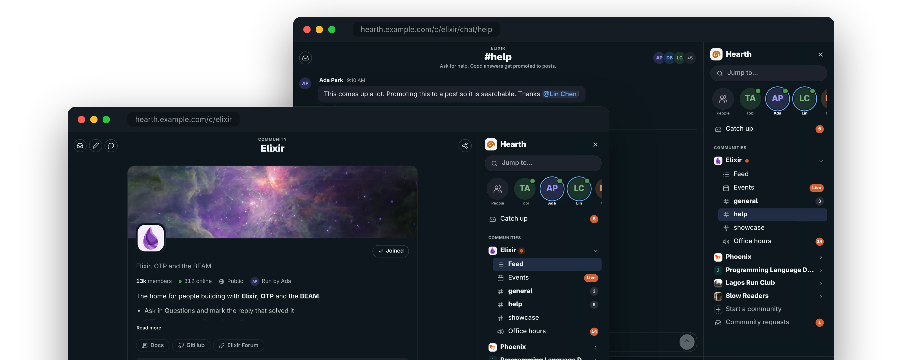
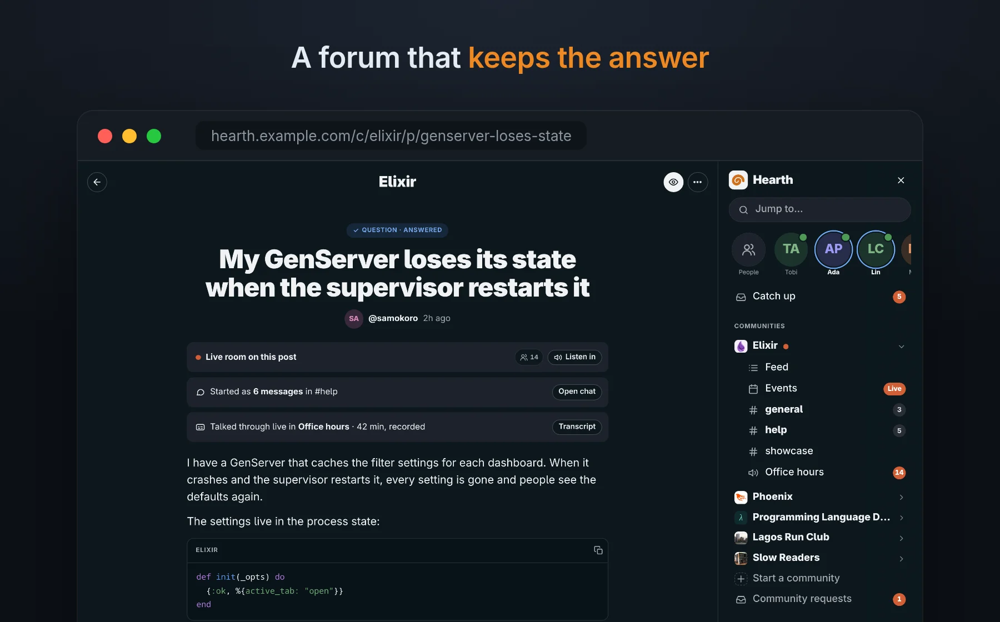
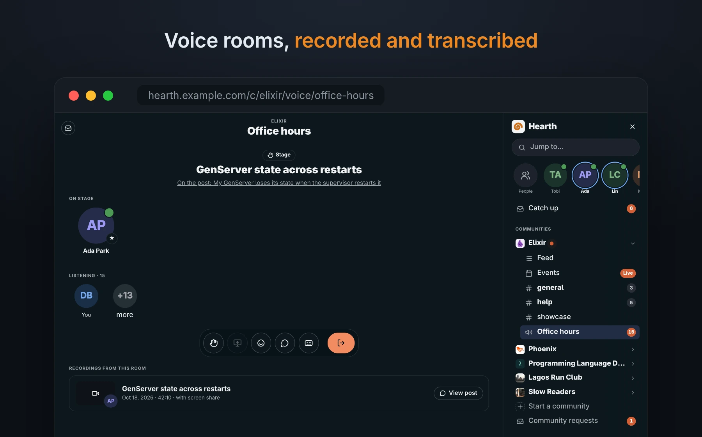
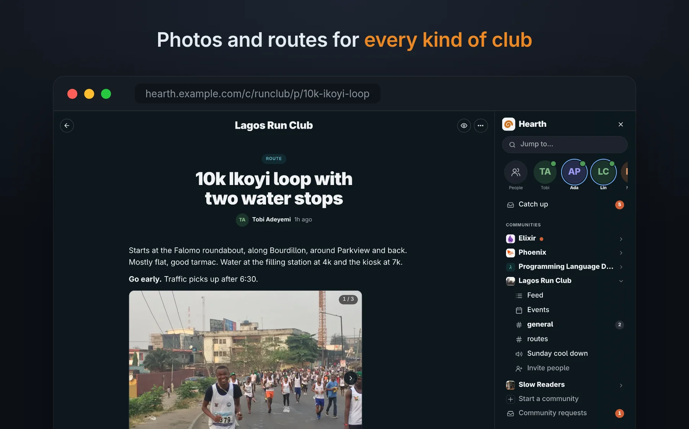
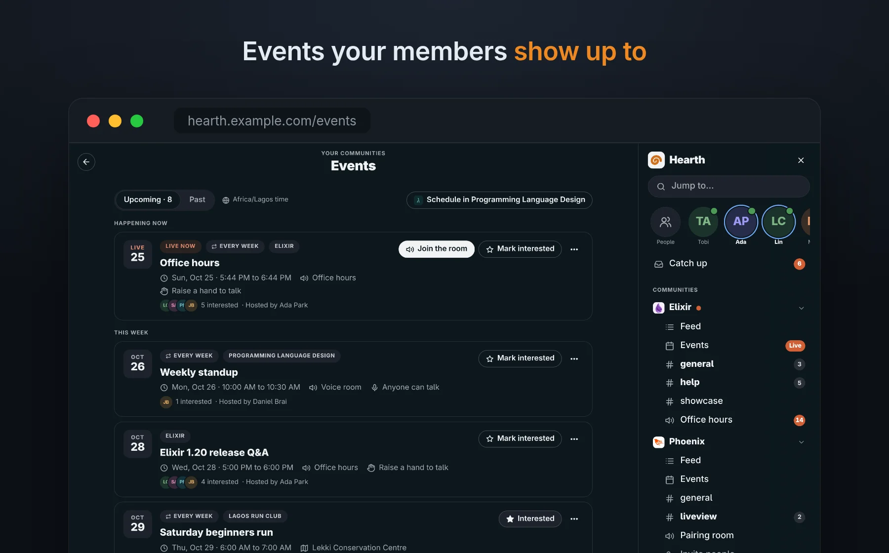

<p align="center">
  
</p>

<h2 align="center">The open source home for your community</h2>

<p align="center">
  A forum, chat rooms, voice rooms and events in one self hosted app.
</p>

<p align="center"><a href="#run-it-locally"> Run it locally</a> · <a href="docs/CONVENTIONS.md"> Conventions</a> · <a href="web/README.md"> Web app</a> · <a href="LICENSE"> MIT license</a></p>

<p align="center">
  
</p>

##  Why Hearth

Most communities are split across a chat app, a forum, a call link and a
calendar. Good answers get lost in the scroll. Hearth puts it all in one place
and keeps what matters as posts. A chat thread can become a post, and a post
talked through live in a voice room keeps the recording and transcript, so
people find it again later.

You run it yourself, so your members' data lives on servers you choose.
Transcripts and screening run on your own machines by default, and nothing goes
to an outside AI service unless you turn one on. Photos and videos have their
location and camera details removed before anyone else can see them.

##  Everything in one place

<table>
  <tr>
    <td width="50%"><p align="center"> Questions that stay answered</p></td>
    <td width="50%"><p align="center"> Voice rooms with recordings</p></td>
  </tr>
  <tr>
    <td width="50%"><p align="center"> Built for every kind of community</p></td>
    <td width="50%"><p align="center"> Events with reminders</p></td>
  </tr>
</table>

-  **Forum** with questions, answers, tags, boosts and photo galleries. Catch up shows what's new across your communities, with email digests
-  **Chat** rooms, replies, mentions, boosts and direct messages, all live. A good thread can become a post
-  **Voice rooms** that are open to everyone or run with a stage, with screen share, recordings and transcripts. A recording takes the name of the event on in the room, and whoever recorded it can rename or delete it. Transcripts and live captions only appear when the instance sets `TRANSCRIPTION=local`, and run on your own server
-  **Events** with reminders
-  **Roles and invites** for each community, by link or by email
-  **Moderation** with reports, a review queue, bans and a public log. Optional screening holds risky posts for a person to decide, and never removes anything itself
-  **Sign in** with an email code, or with Google and GitHub when set up
-  **Installable** as an app, with push notifications
-  **Easy to find** with sitemaps for search engines and a share card drawn for every link

##  Run it locally

You need PostgreSQL, Node and ffmpeg, which converts videos and recordings.
With asdf or mise installed, `make setup` installs the Elixir and Erlang
versions in `.tool-versions` for you. `make install-deps` installs only the
dependencies, without touching the database.

```sh
make setup                # dependencies, database and git hooks
cp .env.example .env      # Google, GitHub, JWT and push keys, if you want them
make dev                  # the API on :4000 and the web app on :5174
```

The first account to sign up runs the instance. After that, `make seed` adds
sample communities for trying moderation, owned by the account named in
`SEED_OWNER`.

`make dev.api` and `make dev.web` start one at a time. Ctrl+C stops both. `make help` lists every target.

To try the app with sample data and no server, run `VITE_HEARTH_DATA=mock pnpm dev` in `web`.

Public screens render on the server, so search engines and link previews get
the content. For a production build run `pnpm build` and then `pnpm start`,
with `PUBLIC_URL` set to the site's address and `API_INTERNAL_URL` to the API's.

Run `make test` for every test in both apps, `make format` to format both, `make lint` for Credo and oxlint, and `make check` before you push. It runs formatting, compiler warnings, Credo, Sobelow, the Elixir tests and the web app's own check. `make coverage` writes a coverage report for the Elixir apps and fails under the minimum in `coveralls.json`. `make clean` removes build output and keeps dependencies.
[docs/CONVENTIONS.md](docs/CONVENTIONS.md) describes how the code is laid out.

### Run it with Docker

Docker runs the whole stack behind Caddy, which gets a certificate for your
domain. Fill in `.env` with at least `PUBLIC_URL`, `PUBLIC_HOST`,
`POSTGRES_PASSWORD`, `SECRET_KEY_BASE`, `JWT_PRIVATE_KEY` and the mail
settings, then start it.

```sh
make up                   # Postgres, the API, the web app and Caddy
make up.dev               # the same, with Mailpit catching email on :8025
make down                 # stops it and keeps the data
```

The files are in `infra/`. To also start coturn, which relays voice for people
behind strict networks, run
`docker compose --env-file .env -f infra/compose.yml --profile voice up -d`.

### Run it on Kubernetes

A Helm chart in `infra/k8s/hearth` runs the API in pools by role (web, media,
ai and voice) with the web server beside them. `HEARTH_ROLES` decides what
each pod starts, so a media pod only processes files and an ai pod only
screens. Secrets come from HashiCorp Vault, which the API reads itself at
boot. There's a values file per environment.

```sh
make k8s.lint                       # checks the chart, offline
make k8s.render ENV=production      # prints the manifests
make k8s.apply ENV=staging          # installs or upgrades in the current context
```

`infra/k8s/README.md` covers setting up Vault, voice networking and the
optional in-cluster Postgres and object storage.

### Update it

Instance settings tells admins when a new version is out. Back up the database
and keep your `.env`, then pull the new version and restart Hearth the way you
installed it. With Docker, `git pull` and `make up` run the migrations before
the new version starts. On Kubernetes, `make k8s.apply` does the same. From a
release, run `bin/migrate` before `bin/server`.

##  Stack

- <a href="https://elixir-lang.org"> Elixir</a> and <a href="https://phoenixframework.org"> Phoenix</a>, with <a href="https://getoban.pro">Oban</a>, <a href="https://postgresql.org"> PostgreSQL</a> and S3 compatible storage
- <a href="https://react.dev"> React</a> and <a href="https://vite.dev"> Vite</a>, with <a href="https://tailwindcss.com"> Tailwind CSS</a> and an API client generated by <a href="https://orval.dev">orval</a>

##  License

[MIT](LICENSE)
